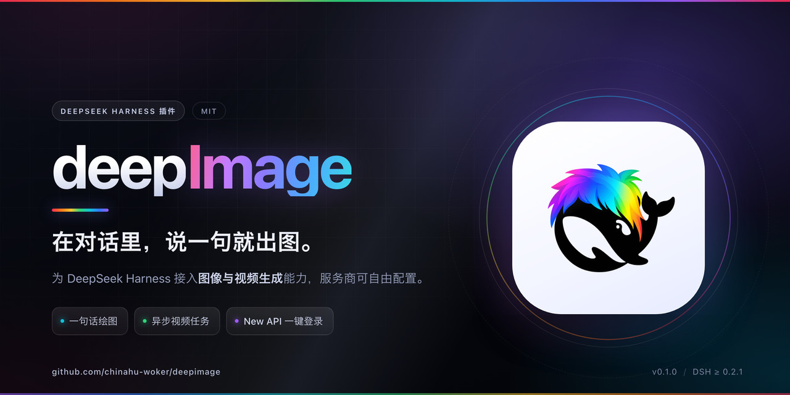

<p align="center">
  
</p>

<h1 align="center">deepImage</h1>

<p align="center">
  为 DeepSeek Harness 接入图片与视频生成，让创意从一句话开始。
</p>

<p align="center">
  <a href="#快速开始">快速开始</a> ·
  <a href="#功能一览">功能一览</a> ·
  <a href="#配置与使用">配置与使用</a> ·
  <a href="README.zh.md">详细文档</a> ·
  <a href="LICENSE">MIT 许可证</a>
</p>

## 选择版本

当前页面介绍 **开源版**：手动配置图片和视频服务商，适合使用自己的 API 服务。公司使用的 [New API 版](https://github.com/chinahu-woker/deepimage/tree/newapi-login) 支持登录 AIKNA 后自动配置兼容模型。

两个版本使用相同的插件标识，请根据需要选择其一安装。开源版的发布标签以 `v` 开头，公司版以 `newapi-v` 开头；下载 Release 时请留意安装包名称。

## 功能一览

- **对话生图**：选择默认绘图服务商后，直接在对话中描述想要的画面。
- **视频生成**：提交异步视频任务，并查询任务状态和结果。
- **灵活配置**：管理多个图片和视频服务商，通过高级配置适配不同的请求与响应格式。
- **凭据管理**：通过 Harness 凭据服务或环境变量提供 API Key。

## 桌面版安装器

下载并解压安装器，打开后可选择开源版或 New API 公司版：

- [下载 macOS 安装器](https://github.com/chinahu-woker/deepimage/releases/download/newapi-v0.1.7/deepImage-installer-macOS.zip)
- [下载 Windows 安装器](https://github.com/chinahu-woker/deepimage/releases/download/newapi-v0.1.7/deepImage-installer-Windows.zip)

安装前请先启动一次 DeepSeek Harness 桌面版，再完全退出。macOS 双击「安装 deepImage.app」；Windows 双击 `Install deepImage.cmd`。安装可能需要联网。

**测试版说明：**macOS 安装器尚未经过 Apple 公证，Windows 安装器尚未签名，也尚未在 Windows 真机验证，系统可能阻止运行。安装步骤和构建说明见 [桌面安装器文档](https://github.com/chinahu-woker/deepimage/blob/newapi-login/installer/README.md)。

## 快速开始

需要安装 DeepSeek Harness、Node.js 和 pnpm。当前开发环境验证的 Harness 版本为 `0.2.1-rc.5`；Harness 仍处于预览阶段，其他版本的插件 API 可能有所差异。

1. 从 [Releases](https://github.com/chinahu-woker/deepimage/releases) 下载开源版安装包，并在下载目录运行：

   ```sh
   dsh plugin --profile web add ./deepimage-open-source-0.1.4.tgz
   dsh --profile web
   ```

   旧版 `v0.1.0` 安装包名为 `dsh-media-generation-0.1.0.tgz`；新发布的开源版安装包使用 `deepimage-open-source-<版本号>.tgz` 命名。如果使用其他 profile，将 `web` 替换为实际名称。安装到正在运行的 profile 后，需要重启该 profile。

   也可以从源码安装：

   ```sh
   git clone --branch main https://github.com/chinahu-woker/deepimage.git
   cd deepimage
   dsh plugin --profile web add .
   dsh --profile web
   ```

2. 打开 **设置 → deepImage**，在“绘图”或“视频”选项卡中添加服务商，填写 API 地址、模型 ID 和凭据引用。

3. 在绘图服务商卡片的更多操作中选择“设为默认”，然后在对话里试试：

   > 画一张雨后霓虹街道的电影感插画。

模型会根据对话内容决定是否调用绘图工具。视频生成则通过创建任务和查询状态获取结果。

## 检查插件更新

安装包含更新功能的版本后，打开 **设置 → deepImage → 设置 → 插件更新**，点击“检查更新”；发现新版本时点击“更新到”即可安装。开源版和 New API 公司版分别检查各自的 Release，更新后按提示重启应用。

公开仓库的更新无需 GitHub Token。旧版本如无法直接更新，可先手动安装一次新版本；本地源码链接不会被自动覆盖。

## 配置与使用

API Key 可保存到 Harness 凭据服务，也可通过环境变量提供。不同服务商的协议和模型参数可能不同，可在高级设置中调整请求体和响应字段路径。

设置页的“生成超时”用于控制单次请求的等待上限；图片生成通常需要较长时间，可按需调高。配置文件中的全局 `timeoutMs` 使用毫秒，未设置时默认为 60 秒。

更多配置、开发与调试说明见 [详细文档](README.zh.md)。

## 打包与发布

```sh
mkdir -p dist
npm run pack:plugin
```

本地打包生成 `dsh-media-generation-<版本号>.tgz`，可通过 `dsh plugin --profile web add <安装包路径>` 安装。

开源版在 `main` 分支维护：更新 `package.json` 版本并提交后，推送对应标签（例如 `v0.1.2`）。GitHub Actions 会生成名为 `deepimage-open-source-<版本号>.tgz` 的 Release 安装包。公司版的标签和发布步骤见 [New API 版说明](https://github.com/chinahu-woker/deepimage/tree/newapi-login#打包与发布)。仓库和 Release 的可见性遵循 GitHub 仓库访问权限。

## 许可证

[MIT](LICENSE)
